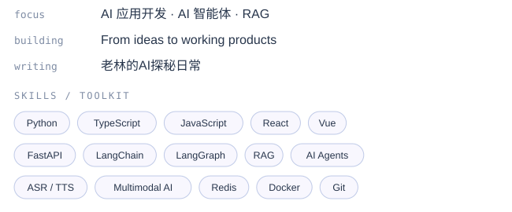
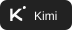
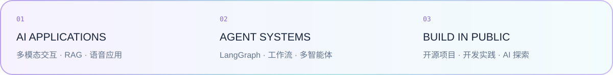

<!-- Banner -->

  

<!-- Original banner stays above; portrait on the left, original blue typing on the right. -->
<table>
<tr>
<td width="50%" align="center" valign="top">

  

</td>
<td width="50%" align="center" valign="top">

</td>
</tr>
</table>

💬 个人微信 · 点击展开二维码

✍️ 微信公众号 · 老林的AI探秘日常 · 点击展开二维码

<b>老林的AI探秘日常</b> 

## 🧑‍💻 About Me

> 🧠 *Software Engineering undergraduate focused on **AI Application Development** and **AI Agents**,
> actively learning AI Agent development and exploring AI applications in healthcare, education, and technology.*
>
> 我是**软件工程专业在读本科生**，主攻**AI 应用开发**与**AI 智能体**方向，目前坚持学习 AI Agent 相关开发，
> 日常将实战代码片段整理至个人 Gist，持续探索 AI 在民生、教育、科技等场景的落地路径。

- 🔭 *Focused on LLM App Development & Multimodal AI Systems* · 目前专注于 **AI 大模型应用开发** 与 **多模态智能系统** 方向
- 🌱 *Learning Python Backend & Multi-Agent Systems* · 正在深入学习 **Python 后端框架** 与 **AI Agent 多智能体开发**
- 🔮 *Exploring Embedded Systems & Intelligent Robotics* · 未来计划拓展**嵌入式开发**与**智能数字机器人**的落地研发方向
- 🏆 *Top 1% in Major, Multiple Scholarships* · 多次获得专业奖学金，连续学年 **专业排名前 1%**
- 🥉 *Regional 3rd Prize in Service Outsourcing Contest · Challenge Cup 3rd Prize* · 服务外包创新创业大赛 **东部赛区三等奖** · 挑战杯 **三等奖**
- 💡 *Proficient in AI Dev Tools & LLMs, with full-cycle project delivery experience* · 熟练使用多款主流 AI 编程工具与大语言模型，具备从需求到交付的全流程实践经验
- 📌 *Goal: Become a Technical Architect who defines products from 0 to 1* · 目标：成为从 0 到 1 定义产品的技术架构师

## 🛠️ Tech Stack 技术图标

### Programming Languages 编程语言

### Backend Frameworks 后端框架

### Frontend Frameworks 前端框架

### AI / ML & Tools AI与工具

## 🤖 AI Development Tools

日常使用的 AI 编程工具与个人智能体。

## 🧠 Familiar LLMs

用于应用开发、方案探索与日常创作的大模型。

## 📂 Featured Projects 项目经历

### 🌟 City as a Story | 迹中局 — 文化旅行互动探索平台
> *2026 年 AI 青年国际黑客松 · 北京线下 3 天开发 · 文化赛道*

> Interactive cultural travel platform built with React + JavaScript + Vite, featuring NPC-guided exploration, branching dialogues, story archives and journey collections. Set in Beijing’s Summer Palace, it offers illustrated storytelling and real-world exploration experiences, with continued iteration after the three-day on-site hackathon.
>
> 基于 React + JavaScript + Vite 构建文化旅行互动探索平台，以北京颐和园为首发场景，结合 NPC 同行、分支对话、故事档案与旅程图鉴，提供插画叙事与实景探索两套体验，实现观察、解谜与记录相结合的响应式 Web 交互，并在北京线下三天黑客松开发后持续迭代。[查看源码 ↗](https://github.com/linyuchao123/jizhongju-web) · [在线体验 ↗](https://jizhongju.xiaolinyx.me)

### 🌟 Beauty Salon Management System | 美客美容全链路门店管理系统
> *校企合作项目 · 核心开发成员*

> SaaS multi-tenant beauty salon platform built with Ruoyi + FastAPI + Vue3 + Redis, featuring async task scheduling via Redis Stream, multi-level caching architecture, and AI-driven development workflow with Harness CI/CD automation.
>
> 基于 Ruoyi + FastAPI + Vue3 + Redis 构建 SaaS 多租户美容门店管理平台，采用 Redis Stream 实现异步任务调度，多级缓存 + 防雪崩架构大幅降低 DB 查询压力，落地 SpecCrew AI 驱动开发流程与 Harness CI/CD 工具，覆盖 5 类核心管理场景，预估预约处理效率提升 80%。

### 🌟 Emotional Companion Digital Human | 数智心屿 — AI 数字人情感陪护系统
> *第十七届服务外包大赛 · 负责人 · 东部赛区三等奖*

> Multimodal emotional companion digital human powered by Qwen2.5-14B + FunASR + CosyVoice + MediaPipe + Live2D, with psychology RAG and real-time lip-sync, achieving 85%+ emotion recognition accuracy with <200ms latency.
>
> 基于 Qwen2.5-14B + FunASR + CosyVoice + MediaPipe + Live2D 构建“感知-认知-干预”主动闭环系统，采用多模态融合情感引擎与心理学知识库 RAG，实现语音识别→情感对话→数字人实时驱动的完整链路，情绪识别准确率超 85%，响应延迟低于 200ms，覆盖 8 类核心陪护场景。

### 🌟 Smart Campus AI Platform | 数治慧民 — 智慧校园 AI 数字人服务平台
> *2026年“挑战杯”参赛项目 · 核心成员 · 三等奖*

> Smart campus AI digital human platform built with LiveTalking + LangGraph ReAct Agent + FAISS RAG, supporting real-time WebRTC interaction, multi-model QA and domain knowledge retrieval across 3 scenarios.
>
> 基于 LiveTalking + LangGraph ReAct Agent + FAISS RAG 三大模块构建智慧校园 AI 数字人平台，支持 WebRTC 实时音视频交互、多模型智能问答与专有知识库检索，覆盖政务咨询、生活服务、学业指导三大场景。

### 🌟 AI Spoken English Trainer | AI英语口语陪练
> *XEngineer 新工科竞赛参赛项目 · 负责人*

> AI-powered spoken English training platform with real-time voice interaction, pronunciation scoring, grammar correction and quantified learning reports across 3 scenarios, using LangGraph dual-Agent workflow.
>
> 基于大模型 + 流式 ASR 构建 AI 英语口语陪练平台，支持面试/点餐/会议三类场景实时语音对话、发音评测、语法纠错与课后量化报告，采用 LangGraph 双 Agent 工作流。

## ✨ Currently Building 持续探索

[浏览我的开源仓库 ↗](https://github.com/linyuchao123?tab=repositories) · [查看 Gist 开发笔记 ↗](https://gist.github.com/linyuchao123) · [访问个人网站 ↗](https://xiaolinyx.me)

## 📬 How to Reach Me

  
  
  

  
  
  

  
  
  

  

 

## 🎯 Skills & Competencies 技能矩阵

| 方向 | 技术与方法 | 实践场景 |
| :--- | :--- | :--- |
| **AI 应用与智能体** | Prompt Engineering · LangChain · LangGraph · RAG · FAISS | 知识问答、Agent 工作流、多智能体协作 |
| **多模态交互** | ASR / TTS · FunASR · CosyVoice · Live2D · WebRTC | 数字人、情感陪护、语音陪练 |
| **后端与数据** | Python · FastAPI · Flask · Django · MySQL · Redis | API 开发、多租户系统、缓存与异步任务 |
| **前端与体验** | JavaScript · TypeScript · React · Vue · Next.js | 响应式网页、交互原型与产品界面 |
| **工程与交付** | Git / PR · Docker · CI/CD · 需求分析 · 技术文档 | 从需求梳理、开发协作到部署交付 |
| **持续学习** | C · Go（学习中） · 嵌入式与机器人（探索方向） | 拓展软件与智能硬件的连接 |
| **证书与语言** | CET-4 · CET-6 · 普通话二级乙等 · 全国计算机二级 | 英文资料阅读、沟通与表达 |

  

  🌟 Thanks for visiting! If you find my work interesting, feel free to star my repos and follow me!

